

# Game Maps

**An in-game map overlay for PC games: searchable locations, your live position,
other players, and teleport. Press a key and it's there.**

<a href="https://youtu.be/pidK20TMtgQ">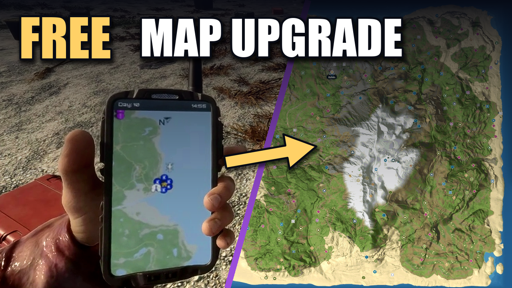</a>

Real gameplay in Sons of the Forest. Click to watch the 44-second showcase on YouTube.

## Features

- **Interactive map** of the whole world, built from the game's own files, with every
  cave, bunker, weapon, tool, key item and collectible pinned. Search and filter
  by category, save the filters you use as a named view, and mark pins as found.
- **Live location** of you, other players in multiplayer, and what the game itself puts
  on its map: companions, placed GPS locators and flags, moved vehicles. Hide these with
  the **In-game markers** category.
- **Teleport** anywhere on the map, to any pin, or to another player, including into
  caves and bunkers, and **teleport back** (Backspace) to where you were.
- **Track** a pin, player, companion or vehicle with an on-screen compass and a
  **waypoint drawn over the game**, follow them on the map, and keep a click-through
  **mini-map** in a corner while you play.
- **Walking routes** to what you track, on the surface and through caves, checked
  against the world as it is (blocked passages are avoided).
- **Nearby creatures**: enemies, companions and animals around you on the map and
  mini-map, including enemy ships in Sunkenland.
- **Play together**: everyone on your server running Game Maps can ask each other to
  track something, ping spots on the map, and share custom pins. See friends' names and
  distances over the game, and optionally share found items and explored areas. Peer to
  peer, no account or server.
- **Order Kelvin from the map** in Sons of the Forest: see how he's doing, send him for
  logs or anything else he can fetch, and help him up.
- **Your bag, marked**: when you die in Sons of the Forest, a pin goes where your gear
  dropped, and it's gone once you pick it up.
- **Collectibles are marked found** as you walk up to them.
- **Custom pins** with your own names, colors and icons. Right-click any pin to track,
  edit or delete it.
- **Notes and timers on any pin**: leave yourself a note, or start a countdown for a
  respawn or a crop. Save your pins to a file, or add pins someone sent you.
- **Keys for while you play**: drop a pin where you stand, or track the nearest thing you
  haven't found, without opening the map.
- **Path history**: a trail of where you've walked since the app started.
- **Picks up where you left off**: what you track, your selection and the map view
  are remembered.
- **Per world**: each save, hosted world and joined world keeps its own found items,
  pins, map state and explored areas.
- **Fog of war**: clouds cover the map and clear where you've been, so nothing gets
  spoiled. Hiding land and hiding pins are separate options, and the reveal distance is
  yours to set.
- **Progress**: how much of each category you've found, and what's left, nearest first.
  Sons of the Forest also has a checklist of keycards, key gear and artifact pieces.
- **Put it where you want it**: drag and resize the map and mini-map over your game. Each
  game keeps its own mini-map layout.
- **Map on a second monitor**: keep the full map open on another screen while you play.
- **Danger alert and pings over the game**: arrows at the screen edge point toward
  hostiles close by, with a count at the top, and friends' map pings show in the game.
- **Recovers on its own**: if a connection or window fails it retries, and the map
  keeps working without live features. If something still goes wrong, one button saves a
  report for [an issue](https://github.com/HYPExMon5ter/game-maps/issues/new/choose).
- **No mod loader and no game files changed.** Works whether you host or join.
- **Always current.** The app and its maps update themselves.

<table>
<tr>
<td width="50%">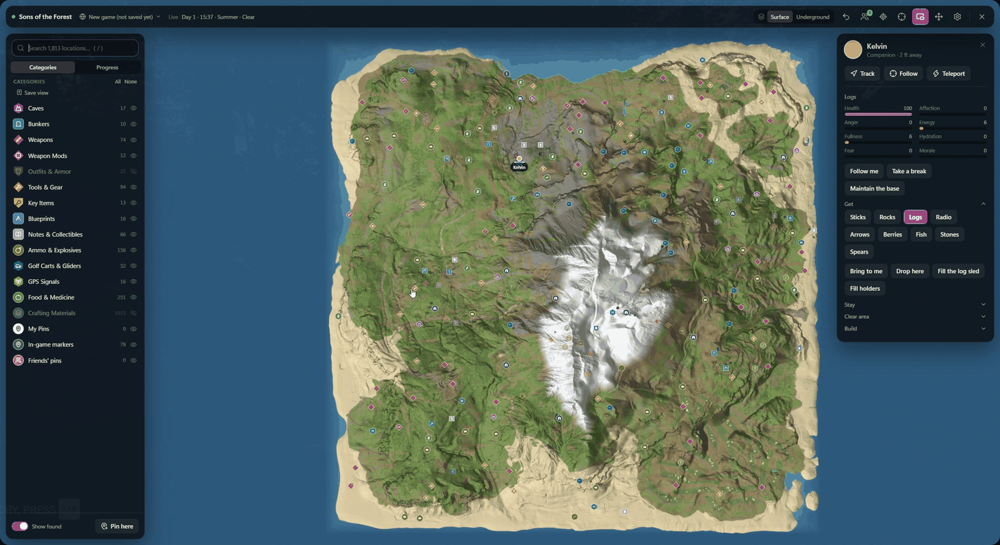 The whole island, every location pinned</td>
<td width="50%">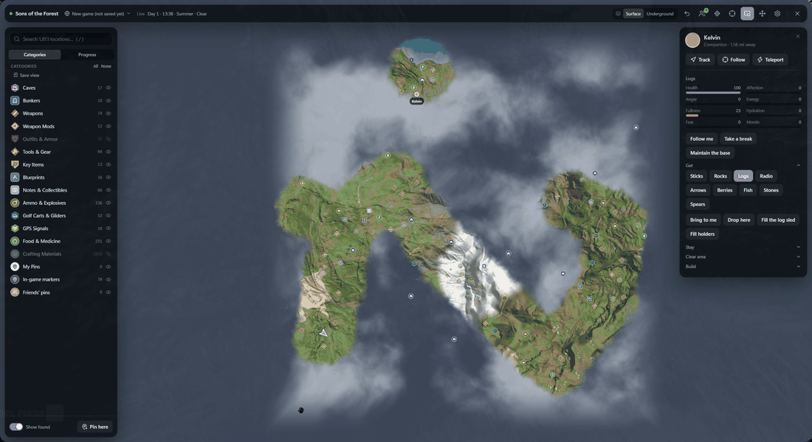 Fog of war: clouds clear where you've been</td>
</tr>
<tr>
<td>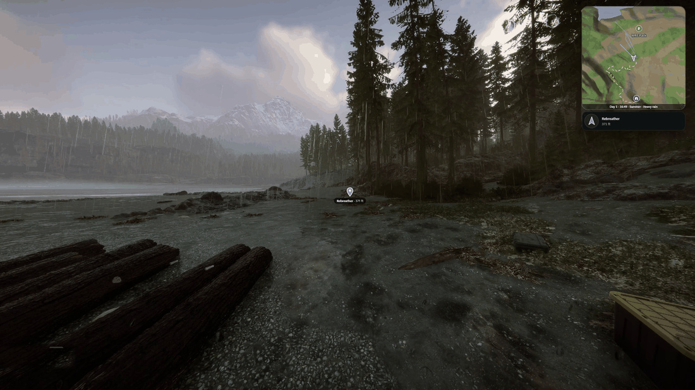 A marker in the world, and the route on your mini-map</td>
<td>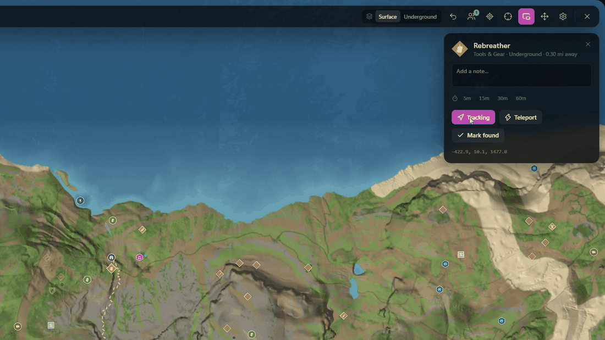 Every pin says what's there; track it, teleport to it or mark it found</td>
</tr>
<tr>
<td>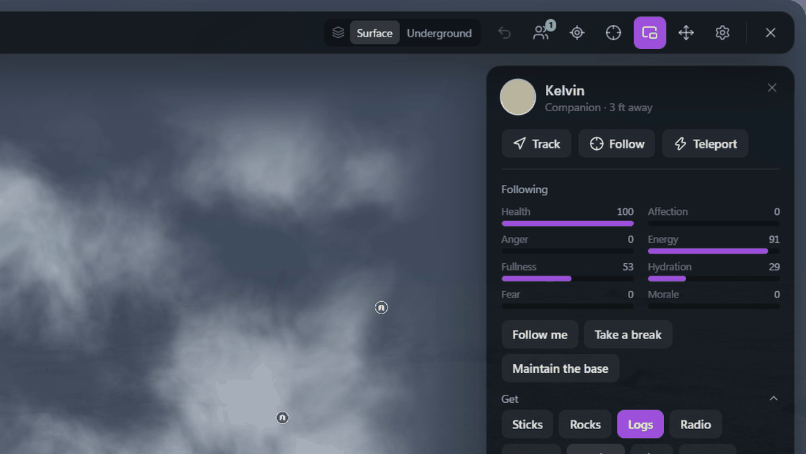 Kelvin's condition and orders, right on the map</td>
<td>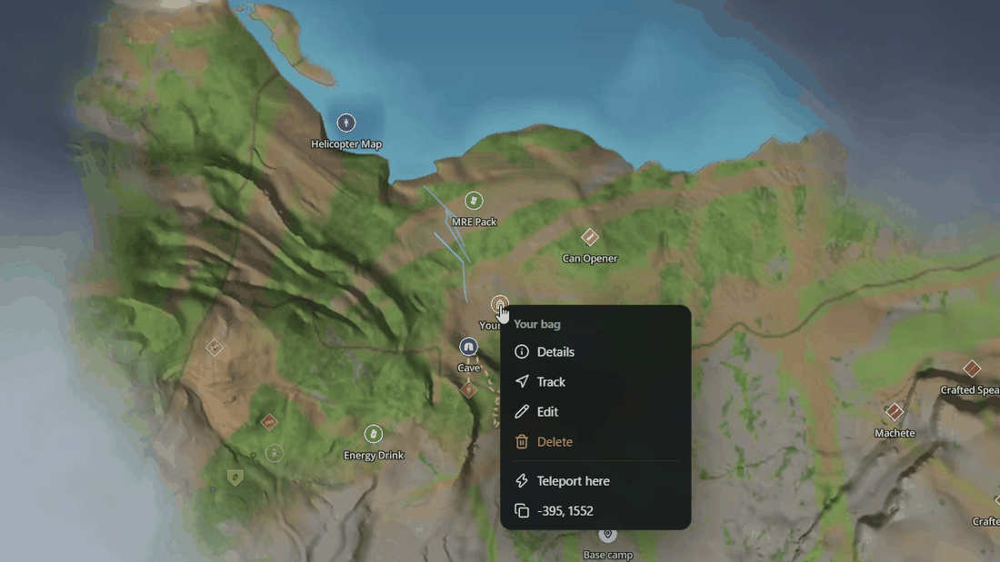 Your bag marked after you die; right-click any pin</td>
</tr>
<tr>
<td>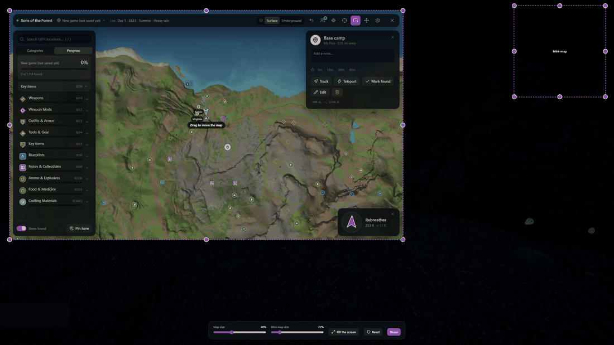 Move and resize the map and mini-map</td>
<td>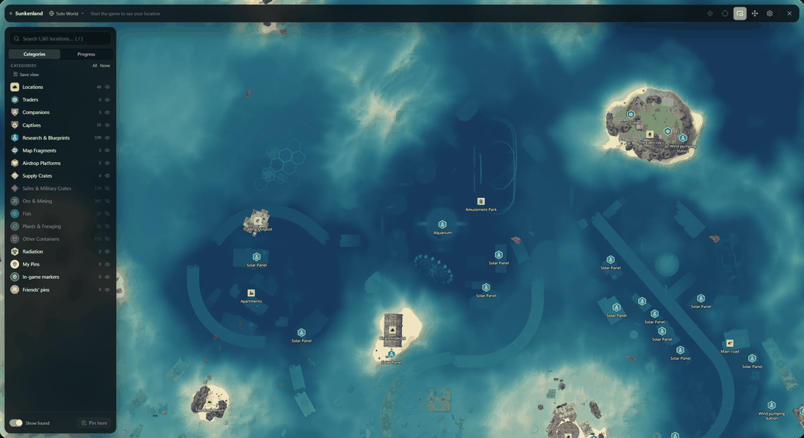 Sunkenland, drawn from the game's own world</td>
</tr>
</table>

## Supported games

| Game | Map | Live location | Teleport | Other players | Nearby creatures | Separate worlds |
|---|:---:|:---:|:---:|:---:|:---:|:---:|
| Sons of the Forest | ✓ | ✓ | ✓ | ✓ | ✓ | ✓ |
| Sunkenland | ✓ | ✓ | ✓ | ✓ | ✓ | ✓ |

More games can be added; see [Adding a game](docs/development.md#adding-a-game).

## Install

1. Download **`Game.Maps_x.y.z_x64-setup.exe`** from the
   [latest release](https://github.com/HYPExMon5ter/game-maps/releases/latest) and run it.
   No administrator rights are needed.
2. If Windows shows *"Windows protected your PC"*, click **More info**, then
   **Run anyway**. The installer isn't code-signed yet.

That's it. Game Maps downloads a game's map the first time you need it and keeps both
the app and your maps up to date. To run it from source instead, see
[Development](docs/development.md#run-the-app).

## Quick start

1. In the game's display settings, set the display mode to **Fullscreen Window**
   (borderless). The map is drawn over the game and can't appear over exclusive
   fullscreen.
2. Open **Game Maps** and choose how you want to play: discover the map as you go, see
   all of it, or see all of it with teleport. You can change this in the settings at any
   time.
3. Choose whether to share anonymous usage counts ([what's sent](#privacy)). Nothing is
   sent unless you choose **Share**.
4. Click **Play**, or start the game as usual.
5. In game, press **M** to open or close the map.

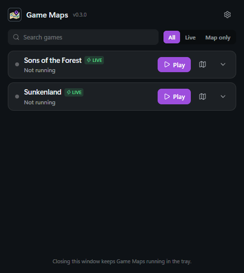

The **Game Maps window** lists your games, one line each, with their status. Search
the list, or show only games with live features (**Live**) or without (**Map only**).
On each game:

- **Play:** start the game through Steam. **Connect** attaches to it when it's running.
- **Map** (map icon): open that game's map without the game, to plan or look something
  up. While a game is running, its own map is the one that opens.
- The **arrow** shows whether the map is downloaded and up to date, and opens that
  game's settings.

The **gear** opens the settings (the same as the map's): grouped by topic, with a
search box. Settings marked with the game icon are kept per game, such as how Game Maps
connects to it, the key that opens its map, and nearby creatures; the rest apply to
every game.

Closing the window keeps Game Maps running in the system tray. Quit it from the tray
icon.

 

## Using the map

| Action | How |
|---|---|
| Open / close the map | **M** (or your key) in game; **Esc** also closes it |
| Zoom | Mouse wheel, or **Num +** / **Num -** (also **=** / **-**). The keys zoom the mini-map while you play too |
| Search | **/** or **Ctrl+F** |
| Add a pin, teleport, ping, copy coordinates | Right-click the map |
| Track, share, teleport to, or mark a pin found | Click the pin |
| Track, edit or delete a pin, or mark it found | Right-click the pin, on the map or in a list |
| Drop a pin where you stand | **F6** while playing |
| Track the nearest thing you haven't found | **F7** while playing |
| Accept a friend's request | **F8** while playing |
| Switch between surface and caves | **Surface / Underground** in the top bar (follows you automatically) |
| Find other players and companions | **Players** in the top bar |
| Mini-map while playing | **Picture-in-picture** in the top bar |
| Move and resize the map and mini-map | **Four arrows** in the top bar |
| Switch world | World name in the top bar |
| See what's left to find | **Progress** tab in the sidebar |
| Keep a set of categories | **Save view** in the sidebar, then click it to switch back |
| Keys, map and mini-map look, what the map shows | **Settings** (gear icon; type to search) |

While Game Maps is connected, the game doesn't see the map key, so only this map
opens (the in-game map works as usual when Game Maps isn't running). The zoom keys and
the F6 to F8 keys can be changed or turned off in **Settings**.

### Pins and tracking

Click a pin for what's there, then **Track** it, **Teleport**, or **Mark found**. Players,
companions and vehicles work the same way, with **Follow** to keep them centered. While
tracking, a compass and a waypoint show over the game, and a walking route shows on the
map (Settings → Tracking turns either off). Hide a whole category with the eye next to
it, and use **Show found** to leave out what you've collected. Collectibles are marked
found when you walk up to them.

Any pin, including the game's, can hold your own note and a countdown of 5 to 60 minutes;
both are in its details. To back up this world's pins or add some from a friend, use
**Pins in a file** under Settings → Map content.

### Kelvin and your bag

In Sons of the Forest, click Kelvin on the map or under **Players** to see his health,
energy and mood and give him orders: follow you, take a break, fetch things, clear an
area or build. If he's hurt, **Help him up** walks you over to him.

When you die, a pin marks the spot. It moves to your bag once the game drops it, so
tracking it leads you to your gear, and it goes away when you pick the bag up. Turn this
off with **Mark where you die** under Settings → Map content.

### Worlds

Game Maps sees which save or world you're in, hosted or joined, and keeps found items,
custom pins, fog of war and the map view separate for each. The world name in the top bar
lists the others, so you can look at them without loading them. A new game that hasn't
been saved yet shows as *New game*, and its data moves to the save the first time you
save.

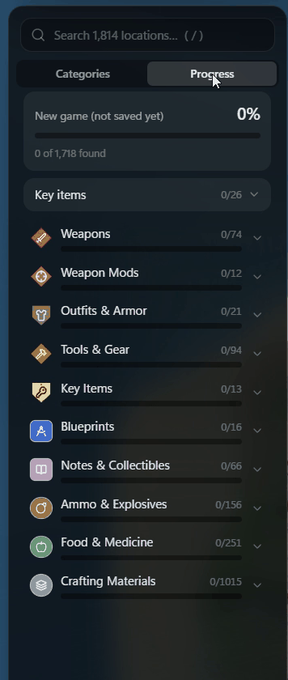

### Progress

The **Progress** tab shows the share of this world's pins you've found and a bar for each
category. Open a category to see what's left, nearest first, and click a row to go to it.
In Sons of the Forest, a checklist above them follows the keycards, key gear and artifact
pieces.

### Fog of war

Your choice on first start, and under Settings → Full map → **Fog of war** after that.
Clouds cover the map and clear around you as you explore.

- **Hide unexplored map** covers unexplored land; turned off, it's only shaded.
- **Hide pins in unexplored areas** hides game pins there, on the map, in search and in
  progress. Your own, found and tracked pins always show.
- **Reveal distance** sets how far around you the map is revealed.
- **Reset explored areas** starts this world over.

 

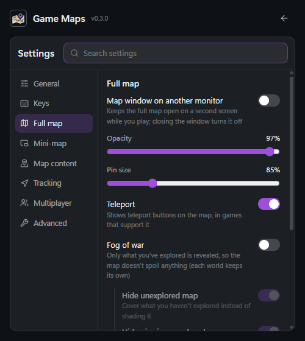

### Mini-map and alerts

The mini-map sits over the game while you're in a world and ignores the mouse. Pick its
corner, size, opacity and rotation under Settings → **Mini-map**, or place it by hand with
the **four arrows** in the top bar; each game keeps its own layout. **Hide for alerts** fades it out
while danger markers or pings are on or next to it, so nothing is hidden behind it. The
overlay goes away when you switch to another app or minimize the game, and comes back with
the game. In games that report them, **Time and weather** adds the day, time, season and
weather.

The **Danger alert** (Settings → Map content) points toward hostiles within the alert
distance, with a count at the top of the screen.

### Second monitor

Turn on **Map window on another monitor** under Settings → Full map, and pick the screen.
It's an ordinary window that follows you live and works like the full map while you keep
playing. Closing the window turns it off.

### Playing together

**Play together** is on by default (Settings → Multiplayer). Everyone in the same
multiplayer session running Game Maps finds each other automatically, with no account or
server.
Right-click to ping a spot, share custom pins (they appear under **Friends' pins**), and
ask each other to track something. **Friends over the game** shows other players' names
and distances, and **Share progress** merges found items and explored areas with friends
who also turned it on. If you can't reach a friend, **Connection check** under
Settings → Multiplayer tests your connection and says what's in the way.

 

## Updates

Game Maps checks for new versions and new map data every 30 minutes and whenever a
game starts.

- **Maps** update on their own. A map that's open on screen switches over when you
  close it.
- **The app** installs new versions on its own as soon as no game is running. If you
  turn off *Install updates automatically*, it asks first instead.

To check right now, use **Check for updates** under Settings → General. The arrow on a
game in the Game Maps window shows its map's state, and a button to download it if it
doesn't arrive on its own.

Your pins, found items and settings stay through updates. They're in
`%APPDATA%\com.gamemaps.overlay`, with a backup of each file from the last start. Map
data, logs and exports are in `%LOCALAPPDATA%\com.gamemaps.overlay`.

Publishing new map data, after a game update moves things, is covered in
[Map data](docs/development.md#map-data) and [Releasing](docs/releasing.md#map-updates).

## Troubleshooting

<b>The map doesn't appear when I press M</b>

- Check that the game uses **Fullscreen Window** (borderless). The Game Maps window
  warns you if it detects exclusive fullscreen.
- Check the game's status in the Game Maps window. It should say **Connected**. If
  hooking is set to *Manually*, click **Connect**.
- If you changed the key, use the one under Settings → Keys → *Open / close map*.

<b>"Game Maps can't connect" or it says the game runs as administrator</b>

Game Maps can't attach to a game that runs with more rights than it has. Quit Game
Maps from the tray, then right-click it and choose **Run as administrator**, or stop
running the game as administrator.

<b>The map is empty</b>

The map downloads the first time it's needed. Check the **Map data** line in the
Game Maps window, which shows progress or any error. You need to be online for the
first download.

<b>The map opens but my position doesn't show</b>

Live features can stop after a game update or a failed connection. Game Maps keeps
retrying, and meanwhile the map key still opens a plain map. Settings → Advanced →
*Connection* shows what's happening. If a game update changed something Game Maps relies
on, [open an issue](https://github.com/HYPExMon5ter/game-maps/issues/new/choose).

<b>The window went black or my pins look wrong</b>

A crashed window reloads, and Game Maps restarts itself if its web view stops, up to 3
times in 10 minutes. After that, quit it from the tray and start it again. A damaged save
file is moved aside at startup (`.corrupt-<time>`) and its last good copy restored.

<b>My antivirus flagged Game Maps</b>

Game Maps attaches to the running game to read your position, the same way other
map and trainer tools do, and some antivirus products flag that behavior. The full
source code is in this repository, and every release is built from it by
[GitHub Actions](https://github.com/HYPExMon5ter/game-maps/actions/workflows/release.yml).

<b>Reporting a problem</b>

Go to Settings → Advanced → **Report a problem** and save a report: your logs and setup
in one file, with your home folder and account name removed. Read it through, since it
has player names from your sessions, then attach it to
[a new issue](https://github.com/HYPExMon5ter/game-maps/issues/new/choose).

## How it works

Game Maps is a [Tauri](https://tauri.app) app (Rust + React +
[MapLibre](https://maplibre.org)). When a supported game starts, it loads a small
Rust agent into the game process. The agent reads the player's position through
Unity's scripting runtime (IL2CPP or Mono) and streams it to the app over a local
named pipe. The map is a separate transparent window drawn over the game, so it
costs the game almost nothing to render.

Map tiles, icons and pins are generated from the game's own files, so they line up
exactly with live positions. They're published separately from the app, so map
fixes reach everyone without an app update.

More detail: [Architecture](docs/architecture.md) ·
[Development](docs/development.md) · [Releasing](docs/releasing.md)

## Privacy

Game Maps asks the first time you open it whether to send anonymous usage counts to
[PostHog](https://posthog.com), so we know how many people use it, what they use and what
breaks. Nothing is sent unless you choose **Share**. To change your answer, use **Share
anonymous usage counts** under Settings → General.

- **When the app starts:** whether this is its first run, whether it started with
  Windows, your Windows build number, your language (`en`, without the country), and
  whether automatic updates and the second-monitor map are on.
- **When a game connects:** which game, the map data version, and whether it connects
  automatically.
- **When the game closes:** how many minutes you played, how many times you opened the
  map and teleported, and whether you tracked something or played with friends.
- **When something fails:** a fixed category, such as `injection` or `map_download`, with
  the game if there is one. Error messages aren't sent.

Each comes with the app version and a random ID made on your computer. Your name, your
in-game location, your pins, your worlds and your multiplayer sessions are never sent.
Location lookup is off and IP addresses aren't kept. The code is in
[`analytics.rs`](apps/overlay/src-tauri/src/analytics.rs).

## License

Game Maps is free to use, change and share for any noncommercial purpose under the
[PolyForm Noncommercial License 1.0.0](LICENSE.md). Selling it or using it commercially
isn't allowed. This covers the app's code, not the games' names and assets.

## Disclaimer

Game Maps is a fan project. It isn't affiliated with or endorsed by the developers
or publishers of the supported games, and all game names and assets belong to their
owners. Use it in single player or with friends who are fine with it. Teleporting in
someone else's multiplayer session changes their game too.

Music in the showcase: "Epic Trailer" by Soundrider/Dope,
[CC BY 3.0](https://creativecommons.org/licenses/by/3.0/), from
[Jamendo](https://www.jamendo.com/track/1670474).
