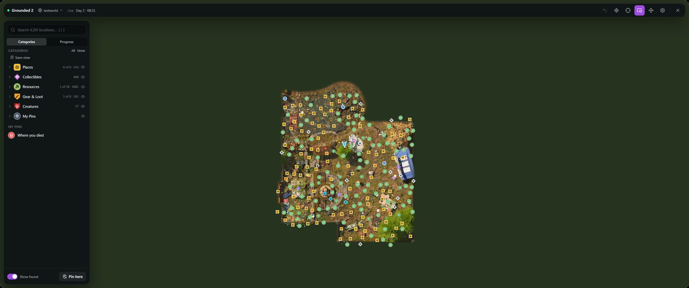

# Game Maps for Grounded 2

**Brookhollow Park and the Abyss on one map, with every landmark, optical disk, raw
science and resource node on it, and you, your friends and the bugs around you live.**

[All games](../../README.md#supported-games) · [Sons of the Forest](sons-of-the-forest.md) · [Sunkenland](sunkenland.md) · [Valheim](valheim.md)

The park, from the game's own map art, with its pins.

## At a glance

| | |
|---|---|
| **Map** | The game's own map of the park and of the Abyss, on one map |
| **Pins** | About 4,200: landmarks, ranger outposts, labs, teleporters, optical disks, notes, keys, recipes, raw science, milk nuggets, resource nodes and more |
| **Live location** | You, other players, nearby bugs and your buggy |
| **Teleport** | Anywhere on the map or to any pin, even somewhere that hasn't loaded yet |
| **Pings in the game** | Your pings become your waypoint in Grounded 2, which everyone sees |
| **Saves** | Each save keeps its own found items, pins and explored areas |

## Every collectible, from the start

The pins come from the game itself, so they're all there before you've explored
anything:

- **Places**: every landmark, ranger outpost, lab and MIX.R, and the teleporters, BURG.L
  stations, resource analyzers and comm arrays.
- **Collectibles**: optical disks, notes and audio logs, keys, recipes and figurines, raw
  science, paint, O.R.C. receivers and upgrade shards.
- **Resources**: every resource node, listed by what it gives (quartzite, spider web,
  sap…), milk nuggets, and buried items.
- **Gear & loot**: unique weapons and gear, loot bags, scientists' remains and buggy eggs.
- **Bosses and named creatures**, where they live.

Collectibles you walk up to are marked found. Open **Progress** to see what's left in each
category, nearest first.

## While you play

- The mini-map, your trail, the in-game time, and a marker over the game for whatever you
  track, with a walking route to it.
- Bugs around you on the map. One that's coming for you or a friend counts as hostile, for
  the danger alert at the edge of the screen.
- Your buggy's health, and orders from the map: call it over, have it follow you or roam,
  or send it home.
- Where you died, and your backpack if you dropped one.
- Hotkeys stay quiet while you're typing in chat.

## Playing together

Everyone in the same world who runs Game Maps finds each other on their own, and can
share pings, pins and what to track. Pings also become your waypoint in Grounded 2, so
friends without Game Maps see them too. Teleporting when you've joined someone else's
world asks their game, the way Grounded 2's own teleporters do.

## Before you start

Play Grounded 2 in **Windowed Fullscreen** (Options → Video), so Game Maps can draw over
it. Steam version only for now.
