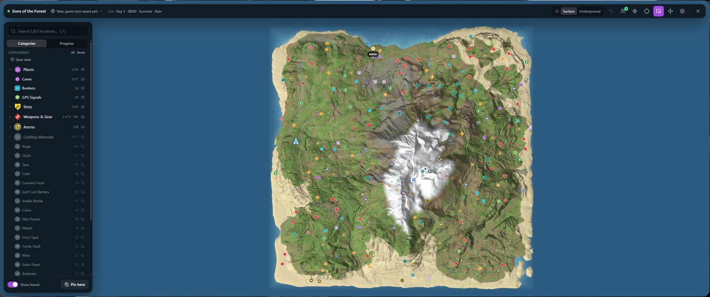
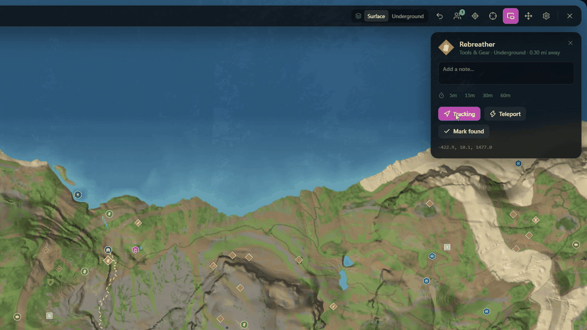
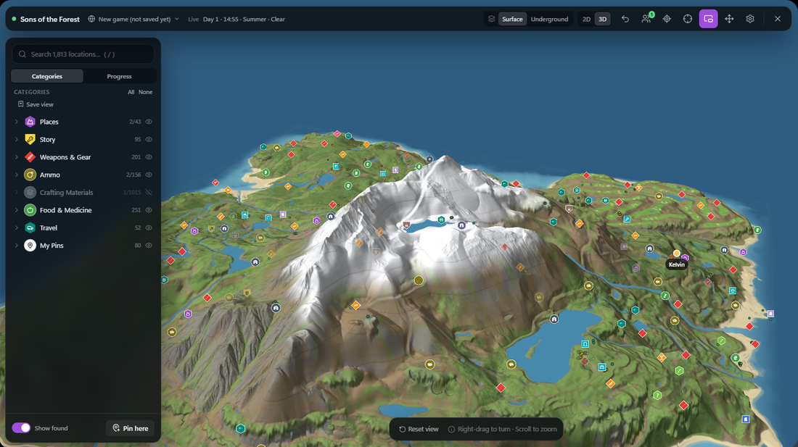
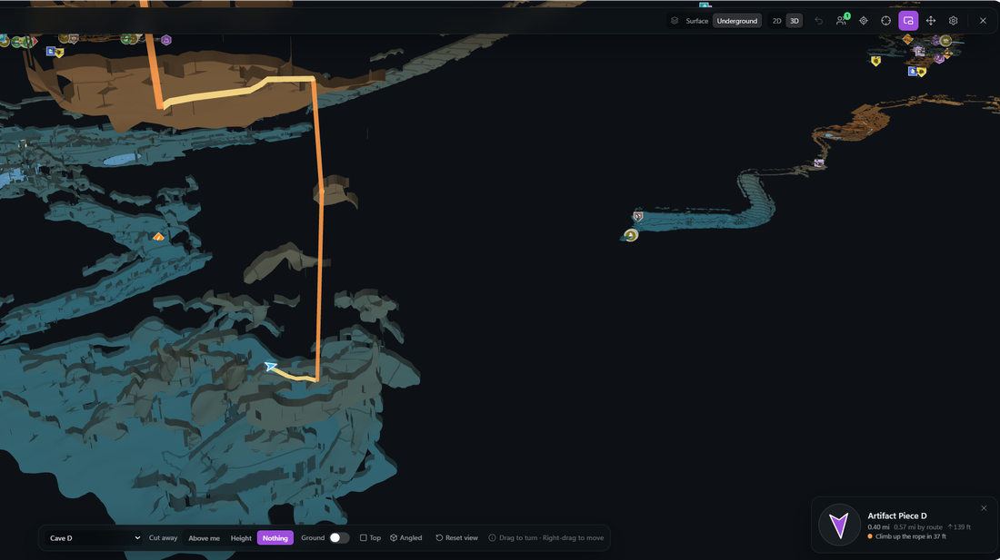
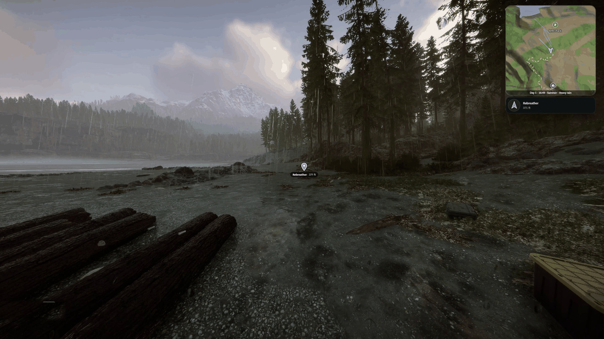
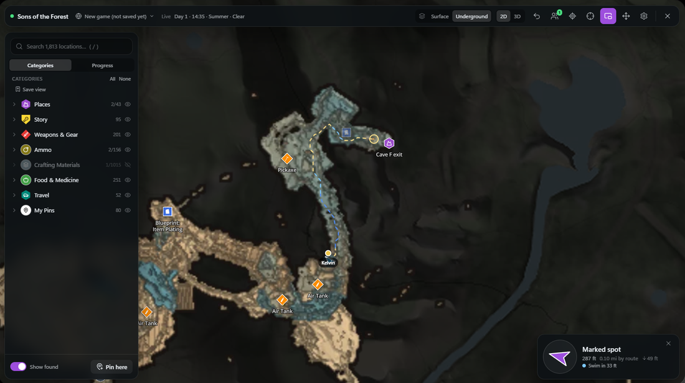
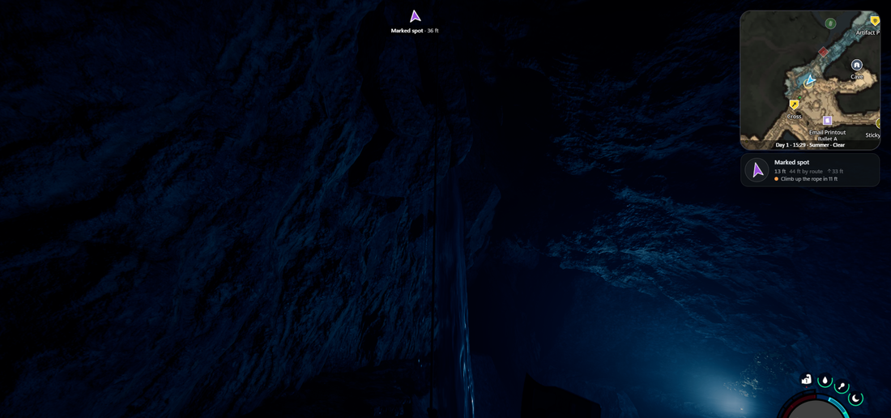
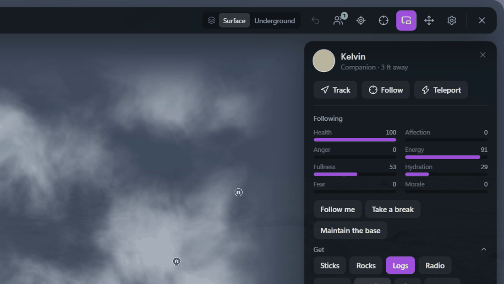
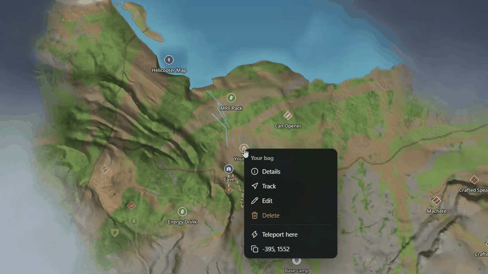
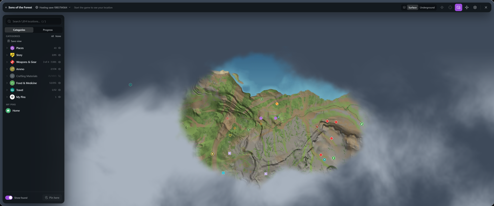

# Game Maps for Sons of the Forest

**The whole island and everything on it, caves and bunkers included, with walking routes
and orders for Kelvin.**

[All games](../../README.md#supported-games) · [Sunkenland](sunkenland.md) · [Valheim](valheim.md) · [Stranded Deep](stranded-deep.md)

The whole island, every location pinned.

## At a glance

| | |
|---|---|
| **Map** | Surface and underground, built from the game's own files, in 2D or 3D |
| **Pins** | About 1,800: caves, bunkers, weapons, tools, key items and collectibles |
| **Live location** | You, other players, Kelvin, GPS locators and vehicles |
| **Teleport** | Anywhere on the map, including into caves and bunkers |
| **Routes** | Walking routes on the surface and through caves |
| **Progress** | A checklist of keycards, key gear and artifact pieces |
| **Time** | Day, time, season and weather on the mini-map |

## The island

Every cave, bunker, weapon, tool, outfit, key item and collectible is on the map, along
with food, medicine, ammo, crafting materials, golf carts and gliders. Search any of them,
or filter down to one thing.

**Surface / Underground** in the top bar switches to the caves, and follows you
automatically when you go in.

Every pin says what's there. Track it, teleport to it, or mark it found.

Caves and bunkers are marked found when you go in, and collectibles when you walk up to
them.

## 3D view

The **2D / 3D** switch in the top bar turns the map 3D. The first time, Game Maps asks
before downloading the 3D map (about 14 MB, on top of the regular map), shows its
progress, and opens it as soon as it's there; it stays up to date from then on. Without
it, nothing extra is downloaded. On the surface the island tilts so you
can see its hills and valleys. Underground, every cave and bunker is shown as open-topped
tunnels: the floor you can walk on, colored by height with a line every 2.5 m, and a low
wall where the cave ends. You can see which tunnels run over or under each other and
where they climb or drop. Everything you can reach from inside a cave is part of it,
ropes, ziplines and underwater passages included. You, other players, pins and your
walking route are shown at their real heights.

- **Drag** to turn around the middle of the view, **right-drag** (or Shift-drag) to
  move, **scroll** to zoom, **double-click** to look at a spot. **Top** looks straight
  down, north up; **Angled** tilts the view to show the levels.
- **Cut away: Above me** hides what's above your level while you're underground, so the
  level you're on is never covered. **Height** lets you pick the cut, to look at one level
  at a time. **Nothing** shows them all.
- Right-click a spot in a cave to add a pin there or teleport to it, at that exact height.
- Where your route can't be walked all the way (the target is under water, say), the
  part you can walk is bright and the rest is a faint line.
- The snow caves are small enough to need no model, and the mini-map stays 2D.

## Walking routes

Track something and a waypoint shows in the world, with a walking route on the map and
mini-map. Routes go through caves too, and use the game's own pathfinding, so blocked
passages are avoided. In caves they climb the ropes, ride the ziplines (downhill, the
only way the game lets you), swim across lakes and pools, dive through flooded passages
and jump down into water, whichever is the simplest way, whatever gear you carry.
Hold E to grab a rope; tap E at the top of a zipline.

- Right-click anywhere and pick **Navigate here** to route to that spot.
- The route line is blue where you swim or dive and orange on ropes and ziplines. The
  compass says what's next ("Climb up the rope in 12 m", "Dive 15 m underwater").
- The compass says how far it is by the route when that's longer than as the crow flies.
- Where a route can't go all the way (a climb it doesn't know), the rest is a
  faint dotted line, and the compass says the route ends short. From the surface, a
  route to something underground leads to the cave's entrance.
- Water shows on the underground map, in 2D and 3D.

## Kelvin

Click Kelvin on the map or under **Players** to see his health, energy and mood, and give
him orders: follow you, take a break, fetch things, clear an area or build. If he's hurt,
**Help him up** walks you over to him. You get a notice when he's hurt or going hungry.

## Your bag

When you die, a pin marks the spot. It moves to your bag once the game drops it, so
tracking it leads you to your gear, and it goes away when you pick the bag up.

## Live markers

What the game puts on its GPS shows on the map: Kelvin, placed GPS locators and flags, and
vehicles you've moved. Nearby cannibals, mutants and animals show on the map and mini-map,
and the danger alert points toward hostiles close by.

## Fog of war

Clouds cover the map and clear where you've been, so nothing gets spoiled.

## Each save has its own map

Game Maps sees which save you're in, hosted or joined, and keeps found items, pins and
explored areas separate for each. A new game shows as *New game* until its first save.

Sons of the Forest has no map marks a player can place, so your pins stay in Game Maps.

## Playing together

Everyone in your game running Game Maps finds each other automatically, with no account or
server. See [Playing together](../../README.md#playing-together).

## Getting started

1. Set the game's display mode to **Fullscreen Window**.
2. [Install Game Maps](../../README.md#install). The map downloads the first time you need
   it.
3. Start the game, and press **M** in the world.

While Game Maps is connected, **M** opens this map and not the game's GPS.

---

Technical notes for this game are in
[docs/games/sons-of-the-forest.md](../games/sons-of-the-forest.md).
