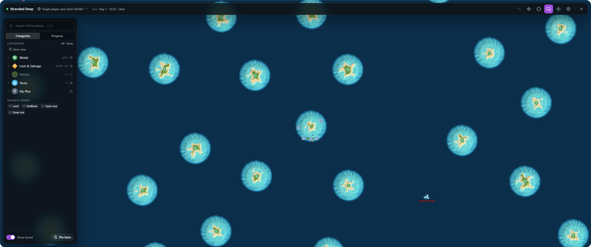
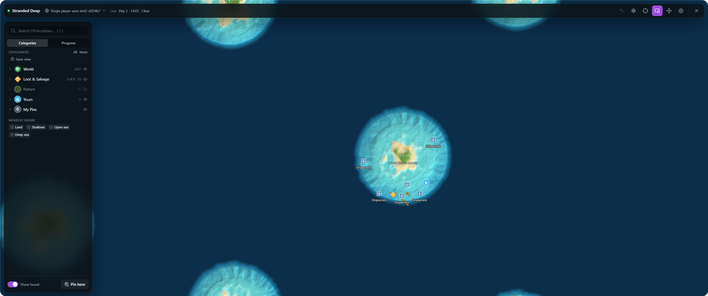
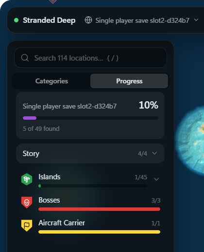

# Game Maps for Stranded Deep

**Every island of your world on one map, drawn from the running game, with the boss arenas
and the carrier marked. Wrecks, crates and plants are remembered as you find them.**

[All games](../../README.md#supported-games) · [Sons of the Forest](sons-of-the-forest.md) · [Sunkenland](sunkenland.md) · [Valheim](valheim.md)

A whole world on the first load. The red marker is Lusca the Great, in its arena.

## At a glance

| | |
|---|---|
| **Map** | Made from your world the first time you load it |
| **Pins** | All 45 islands by name, the three boss arenas and the aircraft carrier; wrecks, loot and plants as you find them |
| **Live location** | You, other players, and nearby sharks, crabs, boars, snakes and bosses |
| **Teleport** | Anywhere on the map, to any pin, island or player |
| **Progress** | The story checklist, the islands you've landed on, and how much you've found |
| **Graphics** | Direct3D 11 |

## A map of your world

Every Stranded Deep world is placed from its own seed, so no download could have yours.
Game Maps draws the map from the game the first time you load a world, and keeps a separate
one for each save slot and seed. Each island's sand, grass and rock comes from its terrain,
and the sea gets lighter over reefs and shallows.

Every island is pinned with its name as the game gives it, along with the three boss
arenas (Megalodon, Lusca the Great and the Great Abaia) and the aircraft carrier. Islands
you've landed on are marked found, including ones you visited before you had Game Maps.

The starting island: shipwrecks around the reef, crates and lockers, and your life raft.

### What's on an island is remembered

What's on an island only exists once you've been near it, so Game Maps remembers it as you
pass:

- **Wrecks and ruins**: shipwrecks, the plane wreck, the sea fort and rowboats.
- **Shelters**, which you can save at.
- **Loot**: crates, lockers, consoles, shipping containers and supply crates.
- **Salvage piles**: tyres, barrels, buoy balls and driftwood.
- **Food and medicine**: potatoes, yucca, kura fruit, quwawa, pipi, wavulavula and
  bananas; aloe vera, ajuga and coca.
- **Clay and stone** to mine.
- **Animal dens**: where giant crabs, boars, hogs and snakes come from.
- **Yours**: your rafts, boats and gyrocopter, your buildings, beds and stills.

Each has its own filter, and the big groups split by kind (only potatoes, only crates).
Nature and salvage start hidden, so the map isn't crowded on the first look.

## The story

The **Progress** tab lists the three bosses and the carrier. Each is ticked once you've
been to it: Game Maps can't yet tell a beaten boss from one you've only seen, so mark one
found yourself if you want the list to say so. Below it, how many islands you've landed on, and how much of each
category you've found.

 

## Nearest land

Lost at sea? Click **Land** under **Nearest biome** to track the closest island, with the
compass showing the way. **Shallows**, **Open sea** and **Deep sea** work the same way,
and hovering the map tells you what's under the cursor.

## While you play

- **The mini-map** shows the islands around you, nearby creatures, the day, time and
  weather.
- **Danger alert**: sharks, giant crabs, boars, snakes and bosses close by are marked over
  the game, with arrows at the screen edge for those out of view. With wildlife set to
  **Passive**, animals don't count as a danger, since they never attack; bosses still do.
- **Death marker**: where you were knocked out gets a pin.

## Teleport

Teleport to any spot, pin or player. Over land you arrive on the ground; over water,
including a wreck's pin, you arrive swimming at the surface above it. **Backspace** takes
you back.

- It's refused while you're on a raft or boat, and while you're knocked out.
- It's refused during a boss fight: the game only ends a fight when you swim away from the
  arena, so teleporting out would leave it running. Swim away first.

## Playing together

Everyone in your online session running Game Maps finds each other automatically, with no
account or server. The host's island pins go to players who join. See
[Playing together](../../README.md#playing-together).

## Getting started

1. Set the game's display mode to borderless (**Fullscreen Window**).
2. [Install Game Maps](../../README.md#install) and start the game.
3. Load or start a game, and press **M**. The first load of a world takes a moment while the
   map is drawn.

The game has no map of its own, so **M** is free for Game Maps.

---

Technical notes for this game are in [docs/games/stranded-deep.md](../games/stranded-deep.md).
