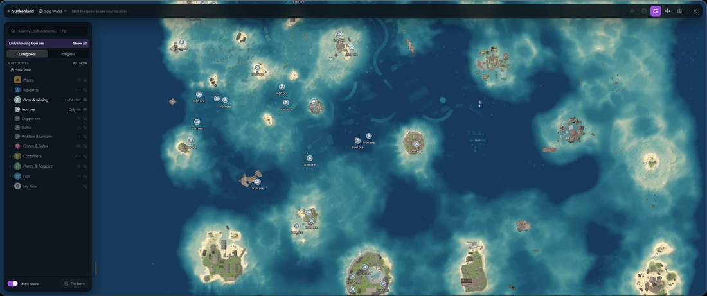
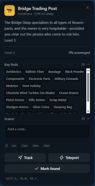
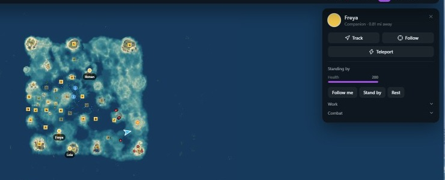

# Game Maps for Sunkenland

**The whole drowned world from above, with what's on each island, your crew's orders, and
marks everyone in the world can see.**

[All games](../../README.md#supported-games) · [Sons of the Forest](sons-of-the-forest.md) · [Valheim](valheim.md) · [Grounded 2](grounded-2.md)

The islands, filtered down to iron ore.

## At a glance

| | |
|---|---|
| **Map** | The whole sea and every island, built from the game's own files |
| **Pins** | About 1,400: locations, traders, ores, research, crates, fish and more |
| **Live location** | You, other players, your crew, nearby enemies and enemy ships |
| **Teleport** | Anywhere on the map |
| **Companions** | Their health and jobs, with orders from the map |
| **Islands** | Each location's level, how much is scavenged, and what's there |
| **Pins in the game** | Your pins become map marks everyone in the world can see |

## The world

Every location, trader and captive is on the map, along with research, map fragments,
airdrop platforms, supply crates, safes and military crates, ores, fish, plants and
containers. Search any of them, or filter down to one thing, such as iron ore.

Places you discover in the game are marked found by themselves.

## What's on an island

Click a location's pin while connected for its level, how much of it you've scavenged, and
the loot, plants and minerals the game lists there. Key finds are crossed off as they're
taken.

 

## Your crew

Click a companion you've recruited for their health, what they're doing, and the same
orders as in the game: follow, stand by, rest, the jobs they can do, charge enemies (they
need a weapon) and hold fire. Right-click the map and choose **Send them here** to send
them to a spot.

You get a notice when one is hurt or going hungry.

## While you play

Track a pin, player or companion and a waypoint shows in the world, with a compass. The
mini-map shows nearby enemies and enemy ships, and has a **wind arrow** in its corner for
sailing. The danger alert points toward hostiles close by.

## Your pins as map marks

Pins you add become marks on the game's map, shared with everyone in the world, so friends
without Game Maps see them too. The game limits how many there can be, and their names are
cut to 8 characters. The game's own marks show in Game Maps as well.

## Each world has its own map

Game Maps keeps found items, pins and explored areas separate for each world, and
**Fog of war** covers the map until you've been there.

## Playing together

Everyone in your world running Game Maps finds each other automatically, with no account
or server. See [Playing together](../../README.md#playing-together).

## Getting started

1. Set the game to **Fullscreen Window** (borderless).
2. [Install Game Maps](../../README.md#install). The map downloads the first time you need
   it.
3. Start the game, and press **M** in the world.

---

Technical notes for this game are in [docs/games/sunkenland.md](../games/sunkenland.md).
