

# Game Maps for Valheim

**A map of your own world, drawn from the running game, with every boss, trader and
dungeon on it. No download needed.**

[All games](../../README.md#supported-games) · [Sons of the Forest](sons-of-the-forest.md) · [Sunkenland](sunkenland.md) · [Stranded Deep](stranded-deep.md)

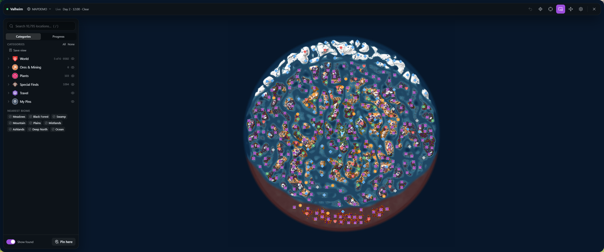

A whole world, biomes and all, on the first load.

## At a glance

| | |
|---|---|
| **Map** | Made from your world the first time you load it |
| **Pins** | Every location in the world if you host. About 10,000 in a new world |
| **Live location** | You, other players, and nearby creatures |
| **Teleport** | Anywhere on the map, to any pin, or out of a dungeon |
| **Progress** | Boss checklist, runestones, and how much you've found |
| **Pins in the game** | Your pins and pings also appear on Valheim's own map |
| **Graphics** | Works on Direct3D 11 and Vulkan |

## A map of your world

Every Valheim world is different, so no download could have yours. Game Maps draws the
map from the game the first time you load a world, and keeps a separate one for each
world. The colors follow the biomes: Meadows, Black Forest, Swamp, Mountain, Plains,
Mistlands, Ashlands, Deep North and Ocean.

Pins cover bosses, Haldor and the other traders, dungeons, runestones, enemy camps, tar
pits, dragon eggs, giant remains, excavation sites, Ashlands sites, and landmarks and
ruins.

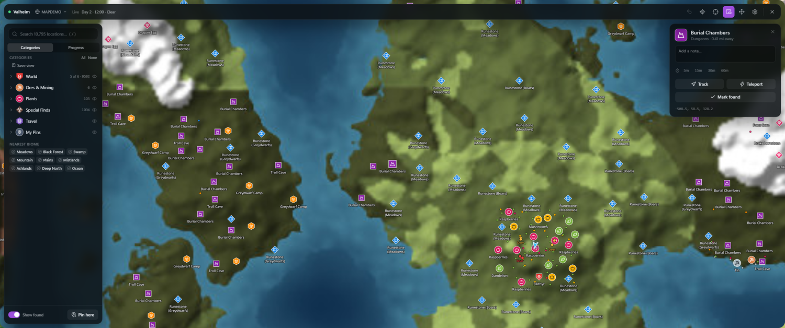

Click any pin to track it, teleport to it, mark it found, or leave a note and a timer.

### If you join someone else's world

The game only tells players who join about bosses, traders and the like. If the host runs
Game Maps too, you get all the same pins they have.

## Find one thing

Filter down to bosses, raspberries or anything else. Open a group, click **Only**, and
**Show all** puts your filters back.

<table>
<tr>
<td width="50%">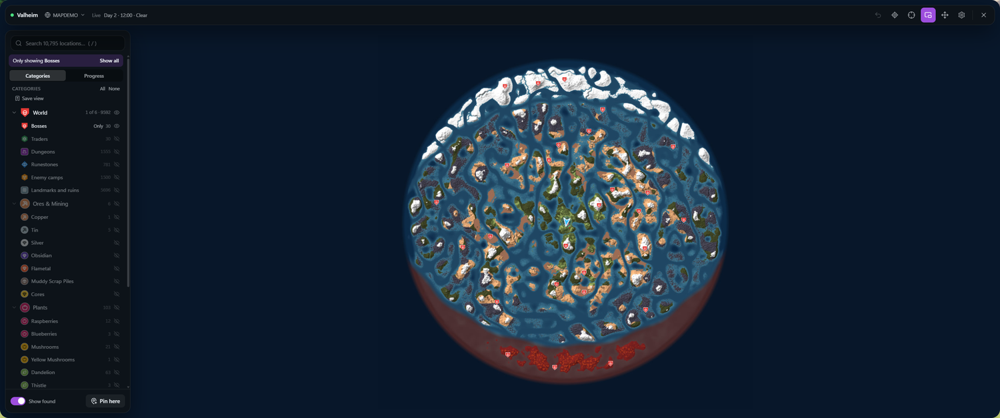 Every boss altar in the world</td>
<td width="50%">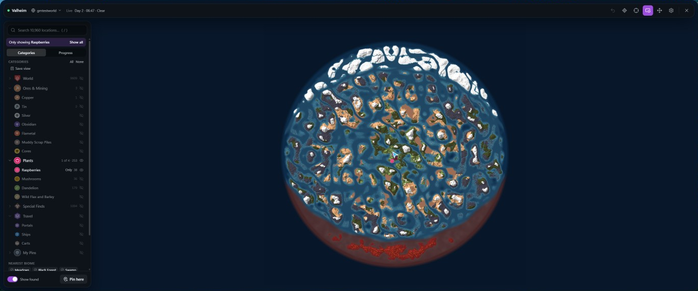 Only raspberries</td>
</tr>
</table>

### Resources you pass are remembered

Ore, plants, ships, carts and portals aren't placed until you get near them, so Game Maps
remembers them as you pass. Each resource has its own filter: copper, tin, silver,
obsidian, flametal, muddy scrap piles, cores, raspberries, blueberries, mushrooms, yellow
mushrooms, dandelion, thistle, and wild flax and barley. Whatever gets mined away goes
from the map.

- **Silver** stays hidden until you pass it with the wishbone on, so nothing is spoiled.
  **Show silver without the wishbone** shows it anyway.
- **Regrowth timers** start a countdown on berries and plants you've picked.
- **Portals** show what they link to, worked out from their tags. If three or more share a
  tag, the pin says so.

## Boss progress

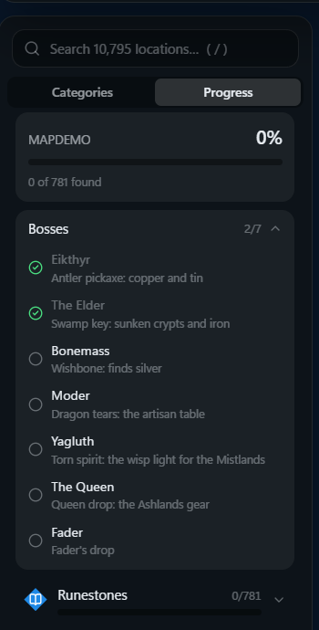

The **Progress** tab follows the seven bosses and ticks each one off when your world
counts it as beaten, with a reminder of what each one unlocks. Below it, each category
shows how much you've found.

Dungeons you enter are marked found by themselves.

 

## Nearest biome

Looking for your first swamp? Click a biome under **Nearest biome** to track the closest
one, with the compass showing how far it is and which way to go. Hover the map to see
which biome is under the cursor.

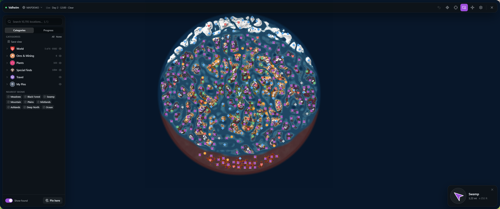

## While you play

Track any pin, player, ship or cart and a waypoint shows in the world, with a compass
under the mini-map. Valheim's worlds are too big for walking routes, so tracking gives you
the straight line.

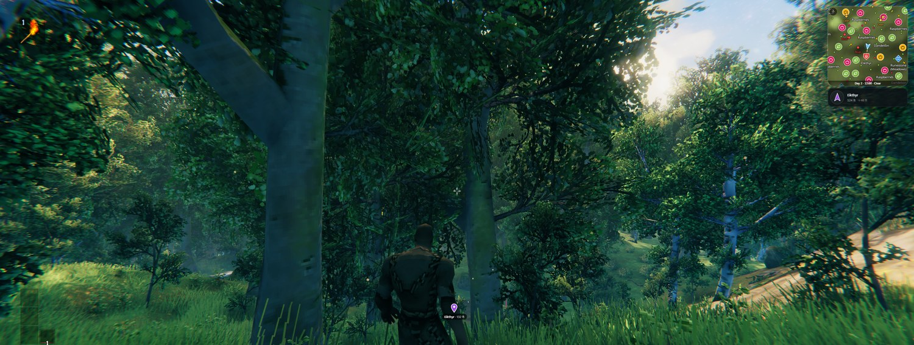

Heading for Eikthyr's altar.

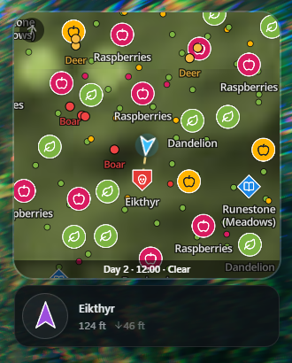

The **mini-map** replaces the game's own while Game Maps is connected:

- Nearby deer, boars and other creatures, with names
- A **wind arrow** in its corner, for sailing
- The day, time and weather
- What you're tracking, below it

 

### Danger alert

Enemies close by are marked over the game, with a count at the top of the screen and
arrows at the screen edge for those out of view.

<table>
<tr>
<td width="50%">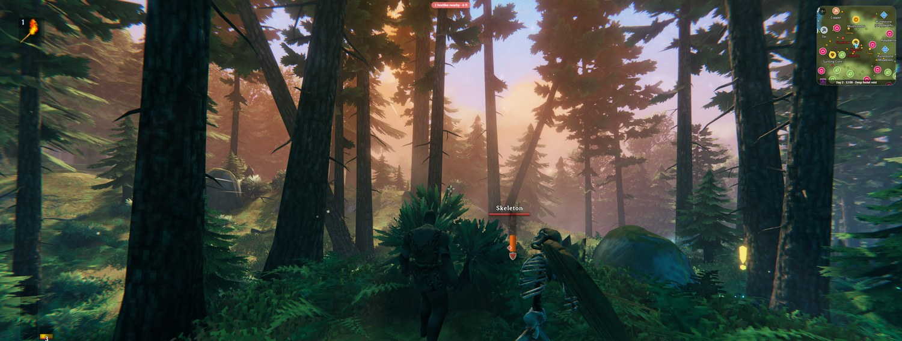 Something's near: a count at the top, an arrow at the edge</td>
<td width="50%">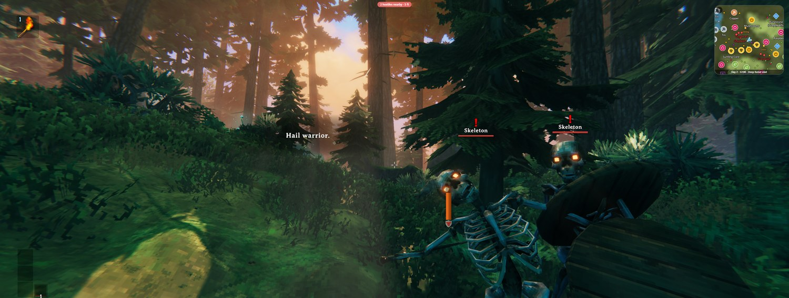 Skeletons at a Burial Chambers, marked at their feet</td>
</tr>
</table>

## Teleport

Teleport to any spot, pin or player. It works like a portal: the game fades out, waits for
the area to load and sets you down safely. **Backspace** takes you back.

- A dungeon's pin takes you to its entrance, and from inside a dungeon you can teleport out.
- It's refused while you're dead, or on a ship or a seat.
- The pause menu stops teleports in single player, because the game's timer stops.
- Like portals, teleports refuse ores and metals. **Teleport with ores and metals** turns
  that off.

## Your pins on the game's map

Pins you add in Game Maps also go on Valheim's own map, saved with your character, so a
cartography table can share them with friends who don't have the app. Pings use the
game's ping, which everyone in the world sees.

Going the other way, the game's pins, beds, boss locations and pings show in Game Maps, and
graves are marked so you can get your things back.

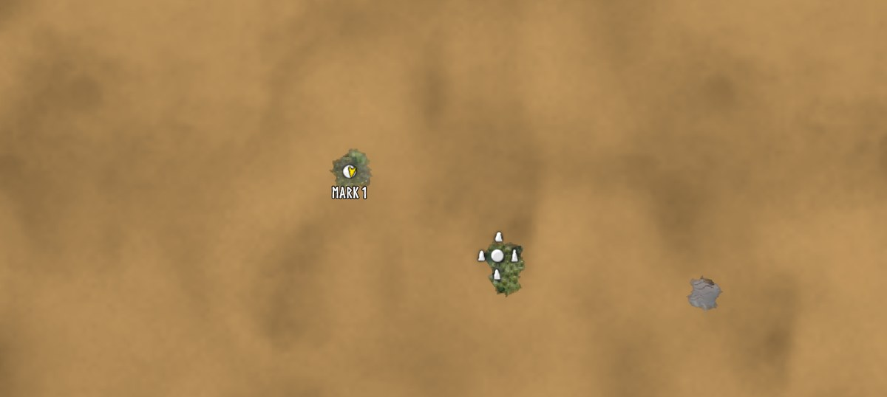

A pin dropped with <b>F6</b> in Game Maps, on the game's map.

## Fog of war

Rather discover the world yourself? Clouds cover the map and clear where you go, and they
pick up what you've already explored in the game, so an old character keeps its map.

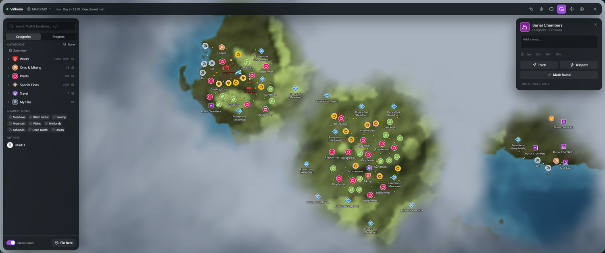

## Valheim's settings

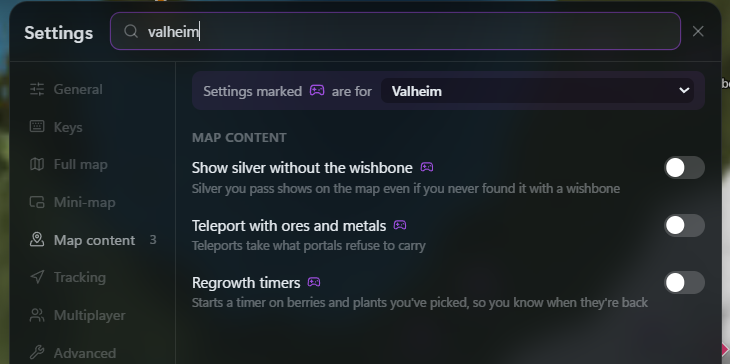

Search **valheim** in the settings to find these. Everything else is in the
[main guide](../../README.md#using-the-map).

## Playing together

Everyone in your world running Game Maps finds each other automatically, with no account
or server. See [Playing together](../../README.md#playing-together).

## Getting started

1. Set the game to **Fullscreen Window** (borderless).
2. [Install Game Maps](../../README.md#install) and start the game.
3. Load a world, and press **M**. The first load of a world takes a moment while the map
   is drawn.

While Game Maps is connected, **M** opens this map and not the game's. The game's own map
works as usual when Game Maps isn't running.

---

Technical notes for this game are in [docs/games/valheim.md](../games/valheim.md).
